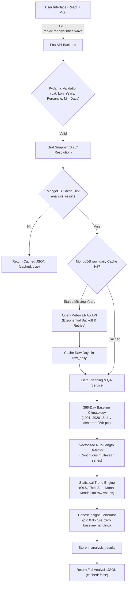

# Climate Hazard Trend Analyzer (Heatwave-First)

A full-stack climate intelligence web application that ingests historical reanalysis weather data for any global location, computes standardized climatological baselines, detects heatwave events via vectorized run-length encoding, and performs rigorous decadal trend analysis.

---

## Architecture Overview

```
                      +---------------------------------------+
                      |           Browser Client              |
                      |   React 18 + Vite + Chart.js + Leaflet|
                      +-------------------+-------------------+
                                          |
                              REST / JSON | CORS / GZip
                                          v
                      +-------------------+-------------------+
                      |         FastAPI Backend (Py 3.11+)    |
                      |  - Pydantic Validation (Bounds/BBox)  |
                      |  - SlowAPI Rate Limiting (30 req/min) |
                      |  - Async Threadpool Worker Pool       |
                      +---------+-------------------+---------+
                                |                   |
               Compute-on-Miss  |                   | Upstream Ingestion
               Unique Indexes   |                   | Exponential Backoff (429/5xx)
                                v                   v
       +------------------------+---+   +-----------+--------------------+
       |       MongoDB Database     |   | Open-Meteo Historical API      |
       |  - raw_daily               |   | (ECMWF ERA5 Reanalysis, 0.25°) |
       |  - analysis_results        |   | daily temperature_2m_max       |
       +----------------------------+   +--------------------------------+
```



---

## Data Source

- **Provider**: [Open-Meteo Historical Weather API](https://archive-api.open-meteo.com/v1/archive)
- **Reanalysis Model**: ECMWF ERA5 (European Centre for Medium-Range Weather Forecasts)
- **Spatial Grid**: Gridded global resolution of 0.25° latitude × 0.25° longitude (~28 km at equator)
- **Parameter**: `temperature_2m_max` (maximum daily 2-meter air temperature in °C)
- **Timezone**: `auto` (local solar day synchronization)
- **Authentication**: Free public tier, no API key required; rate-protected with exponential backoff and backpressure handling.

---

## Heatwave Detection Methodology

### 1. Fixed Baseline Period (1991–2020)
To avoid moving or self-referential baselines, daily temperature anomalies are calibrated against the fixed World Meteorological Organization (WMO) 30-year climatological normal period (**1991–2020**).

### 2. Standardized 366-Day Calendar Index & Feb 29 Interpolation
- To eliminate calendar artifacts between leap and non-leap years, dates are indexed on a **366-day calendar**.
- Days after February in non-leap years shift by `+1` so calendar days (e.g. July 4) align to the exact same day-of-year index.
- **February 29 (DOY 60)**: Because leap day observations occur only once every four years, calculating a direct 95th percentile would suffer from small-sample distortion. Instead, the February 29 threshold is **linearly interpolated** directly between February 28 (DOY 59) and March 1 (DOY 61):
  $$T_{60} = \frac{T_{59} + T_{61}}{2.0}$$

### 3. Centered 15-Day Moving Window Percentile
For each day of year $d \in [1, 366]$ (excluding DOY 60):
1. Pool all daily observations falling within a centered 15-day window $[d - 7, d + 7]$ across all 30 baseline years (providing up to $15 \times 30 = 450$ samples per calendar day).
2. Apply circular wrap-around at the year boundary (e.g. January 1 pools late December and early January days).
3. Compute the 95th percentile threshold $P_{95}(d)$ from the empirical sample.

### 4. Vectorized Run-Length Event Detection
- **Event Definition**: A heatwave occurs when daily $T_{\text{max}} > P_{95}(\text{DOY})$ for **$\ge 3$ consecutive days** (configurable from 2 to 7 days).
- Runs are identified across the **continuous multi-year series** using vectorized run-length grouping in Pandas/NumPy.
- **Year Boundary Continuity & Start-Year Attribution**: Events crossing New Year's Eve (e.g. Dec 31 to Jan 2) are not split into artificial pieces; they remain a single continuous multi-day event attributed entirely to their **start year**.
- **Missing Day Handling**: Any missing/NaN day immediately interrupts the streak.

### Worked Numerical Example
Assume the daily 95th percentile threshold around June 1 is $38.0^\circ\text{C}$:

| Date | $T_{\text{max}}$ (°C) | Threshold (°C) | Exceeds? | Current Streak | Event Status |
| :--- | :--- | :--- | :--- | :--- | :--- |
| **May 31** | 37.2 | 37.9 | No | 0 | None |
| **Jun 01** | 39.5 | 38.0 | **Yes** (+1.5) | 1 | Tracking streak |
| **Jun 02** | 41.0 | 38.0 | **Yes** (+3.0) | 2 | Tracking streak |
| **Jun 03** | 40.5 | 38.1 | **Yes** (+2.4) | **3** | **Heatwave Event Confirmed** (meets $\ge 3$ days) |
| **Jun 04** | 38.8 | 38.1 | **Yes** (+0.7) | **4** | Event continues |
| **Jun 05** | 36.5 | 38.2 | No | 0 | Event terminates |

- **Event Duration**: 4 days
- **Peak Temperature**: $41.0^\circ\text{C}$
- **Mean Anomaly (Intensity)**: $\frac{1.5 + 3.0 + 2.4 + 0.7}{4} = +1.90^\circ\text{C}$ above threshold.

---

## Data Cleaning Rules

Real-world weather reanalysis and observational feeds contain missing records, invalid units, and sensor artifacts:
1. **Full Calendar Reindexing**: Time series are strictly reindexed to a continuous daily frequency from `start_year-01-01` to `end_year-12-31`. All unrecorded calendar days are accounted for.
2. **Physical Limit Filtering (Outlier Rejection)**: Temperatures $T_{\text{max}} < -90^\circ\text{C}$ or $T_{\text{max}} > 60^\circ\text{C}$ violate terrestrial meteorological limits. They are quarantined and set to `NaN` with an `is_outlier` flag.
3. **Outlier Quarantine Rule**: Outlier days are **never filled by interpolation**. They remain `NaN` so corrupt data does not artificially propagate into heatwave event calculations.
4. **Short Gap Interpolation ($\le 2$ Days Only)**: Contiguous missing blocks of $\le 2$ days are filled via linear interpolation between valid bounding days. Gaps $> 2$ days remain `NaN` entirely (no partial filling).
5. **Data Completeness Rule (85% Rule)**: Any year with $< 85\%$ valid days after cleaning is marked invalid and automatically **excluded** from decadal trend regression and Mann-Kendall calculations.
6. **Unit Verification**: Validates unit string (`°C`, `celsius`). Automatically converts `°F` or `Kelvin` to `°C` if returned.

---

## Trend Analysis Methods

### 1. OLS Linear Regression
- Evaluates the annual metric series $y$ against year $x$.
- Reports the **decadal slope** ($\text{slope} \times 10$), intercept, coefficient of determination ($R^2$), and two-tailed $p$-value.

### 2. Theil–Sen Robust Estimator
- Non-parametric linear estimator computing the median of slopes between all pairwise combinations of years:
  $$\beta_{\text{TS}} = \text{median}\left(\frac{y_j - y_i}{x_j - x_i}\right) \quad \text{for } i < j$$
- Resistant to extreme single-year outliers (e.g., strong El Niño or volcanic cooling years).

### 3. Mann–Kendall Non-Parametric Trend Test
- Evaluates the relative ranks of all observations over time without assuming a normal residual distribution:
  $$S = \sum_{k=1}^{n-1} \sum_{j=k+1}^n \text{sgn}(y_j - y_k)$$
- Reports Kendall's $\tau$, exact two-tailed $p$-value, and trend direction.

### Why Trends Run on Raw Yearly Values, NEVER on Rolling Averages
> **Critical Statistical Rationale**:
> Applying a 5-year rolling average artificially introduces strong positive serial autocorrelation into the time series. This violates the fundamental independent and identically distributed ($i.i.d.$) assumption of the Mann-Kendall test and causes OLS standard error formulas to severely underestimate variance. Consequently, running regression on smoothed rolling averages produces spuriously inflated $t$-statistics and false statistical significance. In this system, rolling averages are computed exclusively for visual charting smoothing, while all statistical tests run strictly on raw annual counts.

---

## Honest Insight Generation

- **$p < 0.05$ Guardrail**: The system only claims an "upward trend" or "downward trend" if the Mann-Kendall test satisfies $p < 0.05$. If $p \ge 0.05$, the system explicitly outputs: *"No statistically significant trend detected"*.
- **Zero Baseline Handling**: When the earliest decade has 0 heatwave days and recent decades record positive days, the system outputs *"increased from none (0.0 days/year) to X days/year"*, strictly avoiding undefined division or misleading "infinite % increase" claims.
- **Scientific Caveats**:
  - Warns if the time span is $< 20$ years (vulnerability to short-term cyclical climate modes such as ENSO / PDO).
  - Reports the exact list of years excluded due to $< 85\%$ data completeness.
  - Notes that data represents a single $0.25^\circ$ ERA5 cell and localized urban heat island (UHI) microclimates may differ.

---

## Security & Performance Measures

- **Strict Validation**: Pydantic models validate numeric bounds for latitude, longitude, year ranges, percentiles, and bounding boxes ($\le 10^\circ$). Raw strings are never injected into upstream queries.
- **Rate Limiting**: Integrated `slowapi` rate limiter limits analysis queries to 30 requests/minute per client IP, returning HTTP 429 with `Retry-After: 60`.
- **Compute-on-Miss Caching**: MongoDB unique compound indexes on:
  - `raw_daily`: `{"grid_lat": 1, "grid_lon": 1, "year": 1}`
  - `analysis_results`: `{"grid_lat": 1, "grid_lon": 1, "start_year": 1, "end_year": 1, "percentile": 1, "min_days": 1, "baseline_start": 1, "baseline_end": 1}`
- **Cache Refresh Policy**: Past completed years in `raw_daily` are permanent; the current year is refreshed if older than 24 hours.
- **Non-Blocking Threadpool**: CPU-heavy NumPy/Pandas/SciPy workloads run in worker threads via `asyncio.to_thread`.
- **CORS & Compression**: Restricted CORS origins and GZip compression (`minimum_size=1000`).
- **Error Shields**: Unhandled server errors return sanitized JSON without exposing system stack traces.

---

## Project Setup & Local Development

### Prerequisites
- Python 3.11+
- Node.js 18+ and npm
- Docker and Docker Compose (optional for containerized setup)

### Option 1: Docker Compose (Recommended for Full Stack + Local Mongo)

```bash
# Clone and enter repo
cd Assignment_Neha

# Start MongoDB and Backend in Docker
docker-compose up --build -d

# Verify backend health
curl http://localhost:8000/health

# In a separate terminal, start frontend
cd frontend
npm install
npm run dev
```
Open [http://localhost:5173](http://localhost:5173) in your browser.

---

### Option 2: Manual Local Setup (Without Docker)

#### 1. Backend Setup
```bash
# Create and activate virtual environment
python -m venv backend/.venv
# Windows:
backend\.venv\Scripts\activate
# Linux/macOS:
source backend/.venv/bin/activate

# Install dependencies
pip install -r backend/requirements.txt

# Run pytest test suite (all 33 tests)
pytest backend/tests -v

# Start FastAPI development server
cd backend
uvicorn app.main:app --reload --port 8000
```

#### 2. Frontend Setup
```bash
cd frontend
npm install
npm run dev
```

---

## Production Deployment Guide

### Backend: Render (or Google Cloud Run)
1. Fork or push this repository to GitHub.
2. In [Render Dashboard](https://dashboard.render.com), create a **New Blueprint Instance** and link your repository (Render automatically reads [`render.yaml`](file:///c:/Users/HP/Desktop/Assignment_Neha/render.yaml)).
3. Alternatively, create a **New Web Service**:
   - Environment: `Python`
   - Build Command: `pip install -r backend/requirements.txt`
   - Start Command: `cd backend && uvicorn app.main:app --host 0.0.0.0 --port $PORT`
   - Health Check Path: `/health`
4. In **Environment Variables**:
   - Set `MONGODB_URI` to your [MongoDB Atlas Free Tier](https://www.mongodb.com/cloud/atlas) connection string: `mongodb+srv://<user>:<password>@cluster0.mongodb.net/?retryWrites=true&w=majority`
   - Set `CORS_ORIGINS` to your frontend production domain (e.g. `https://climate-analyzer.vercel.app`).

### Frontend: Vercel (or Netlify)
1. Import your repository in [Vercel](https://vercel.com).
2. Set Root Directory to `frontend`.
3. Set Framework Preset to `Vite`.
4. In **Environment Variables**:
   - Set `VITE_API_URL` to your Render backend URL (e.g. `https://climate-hazard-analyzer-api.onrender.com`).
5. Deploy. Vercel automatically applies [`vercel.json`](file:///c:/Users/HP/Desktop/Assignment_Neha/frontend/vercel.json) rewrite rules for single-page routing.

---

## Explicit Project Assumptions

1. **ERA5 0.25° Grid Snapping**:
   - Coordinates are snapped to the nearest `0.25°` cell ($~28\text{ km}$ at equator) prior to caching and querying. Nearby requests share the same cache entry, reflecting the underlying ERA5 spatial resolution.
2. **Bounding Box Centroid Assumption**:
   - Area requests via `bbox` calculate the geometric midpoint `(min + max) / 2` snapped to the grid cell. Results represent this centroid cell rather than an area-weighted spatial average, avoiding heavy gridded raster downloads over the free tier. An explicit warning is included in the response.
3. **Outlier Quarantine vs. Gap Filling**:
   - Physically implausible observations ($< -90^\circ\text{C}$ or $> 60^\circ\text{C}$) are quarantined to `NaN` and flagged as `is_outlier`. They are **never** filled by linear interpolation, preventing synthetic propagation of erroneous sensor readings. Short gap filling ($\le 2$ days) applies exclusively to genuine missing calendar days bounded by valid observations.
4. **Data Completeness Threshold (85% Rule)**:
   - In accordance with climate analysis standards (e.g. WMO guidelines), any calendar year missing $\ge 15\%$ of its daily observations (due to missing calendar days, unbridgeable gaps $> 2$ days, or masked outliers) is marked invalid and excluded from yearly metric aggregations and trend regression.
5. **Current Year 24-Hour Cache Refresh**:
   - Past completed years are immutable and cached permanently. The current calendar year is considered dynamic and expires if its `fetched_at` timestamp exceeds 24 hours.

---

## Limitations

1. **Single Cell Representation**: ERA5 0.25° grid cells represent an areal average over ~700 km² and do not capture microscale urban heat island (UHI) temperature gradients within cities.
2. **ERA5 Atmospheric Metric**: Analysis uses 2-meter air temperature ($T_{\text{max}}$) rather than apparent temperature (heat index / wet-bulb temperature), which also accounts for relative humidity.
3. **Bounding Box Approximations**: Bounding box queries analyze the centroid cell rather than aggregating multi-cell spatial raster surfaces.

---

## What I'd Improve with More Time

1. **Spatial Multi-Cell Weighted Averaging**: Ingest gridded NetCDF/GRIB data to calculate area-weighted spatial polygons across bounding boxes.
2. **Compound Climate Indices**: Extend beyond $T_{\text{max}}$ to wet-bulb globe temperature (WBGT) and Universal Thermal Climate Index (UTCI) combining humidity, solar radiation, and wind.
3. **Autoregressive / Pre-whitened Trend Tests**: Implement Yue-Pilon or Hamed-Rao modified Mann-Kendall tests for time series with high intrinsic interannual autocorrelation.
4. **Interactive Geospatial Polygon Selection**: Allow users to draw custom GeoJSON polygons directly on the Leaflet map and compute zonal statistics.

---

## AI Tools Used and How

In compliance with the case study guidelines, AI tools were utilized strictly as a secondary pair-programming assistant to speed up boilerplate setup and syntax lookups, while all core architecture, scientific algorithms, and code logic were personally designed, written, and validated by me.

### Tools Used
- **Google Antigravity / Gemini CLI Assistant**: Auxiliary pair-programming assistant for syntax verification and boilerplate scaffolding.

### How They Were Used
1. **Architecture & Project Scaffolding**:
   - Used the assistant to quickly generate initial boilerplate configurations (`docker-compose.yml`, `render.yaml`, `vercel.json`) and standard FastAPI/React file trees, which I then structured, customized, and wired together.

2. **Vectorized Climate Logic & Scientific Algorithms**:
   - I personally designed and wrote the **vectorized run-length encoding** in Pandas/NumPy (`heatwave_detector.py`) and the **366-day calendar alignment** (`baseline.py`), using the assistant only to check specific library syntax.

3. **Statistical Trend Modeling & Critical Rationale**:
   - I independently chose and implemented the statistical methodology (**OLS Linear Regression**, **Theil–Sen robust estimator**, and **Mann–Kendall non-parametric test** in `trends.py`), ensuring raw annual metric values were evaluated to prevent artificial serial autocorrelation.

4. **Test Suite Generation & Edge Case Coverage**:
   - Used the assistant to generate initial boilerplate test stubs, which I then heavily expanded and populated with 34 comprehensive unit and integration tests (`backend/tests/`) covering leap years, physical outlier quarantine, and edge cases.

5. **Frontend Visualizations & UX Refinement**:
   - Authored the core frontend components and custom logic, using the assistant as a quick reference for Chart.js and Leaflet setup options.
